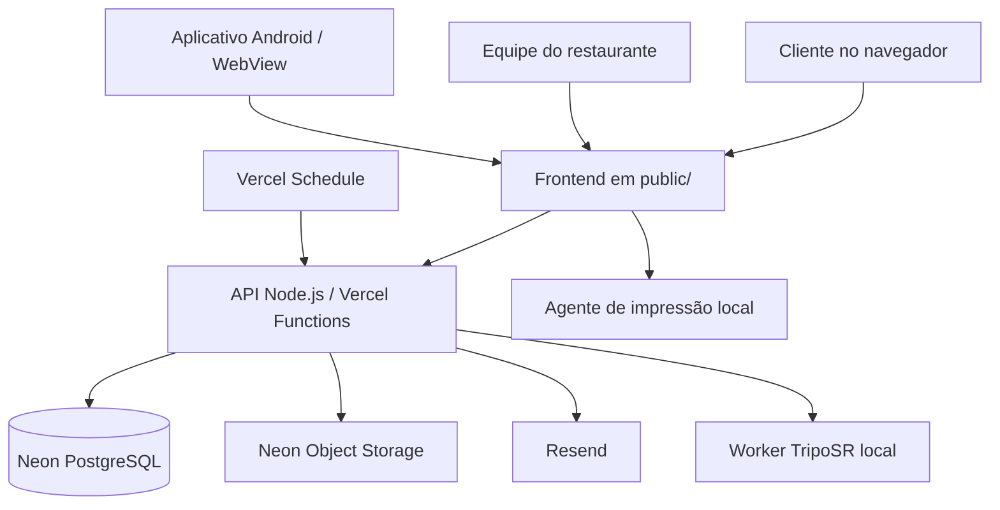

# Como o Menuza funciona

Este documento descreve a arquitetura implementada, o fluxo operacional e as responsabilidades de cada serviço do Menuza. Ele serve como referência para desenvolvimento, implantação, suporte e operação do restaurante.

> **Escopo atual:** uma instalação para um único restaurante. O identificador interno do restaurante é definido no backend. Não há isolamento multi-tenant comercial nem módulo de estoque.

## 1. Visão geral

O Menuza possui quatro partes principais:

1. **Cardápio web:** interface pública utilizada pelo cliente.
2. **Painel administrativo:** interface protegida utilizada pela equipe do restaurante.
3. **API e banco:** regras de negócio, autenticação e persistência.
4. **Serviços auxiliares:** armazenamento de arquivos, e-mail, geração 3D e impressão local.

Em produção, a interface estática é servida pela Vercel. As requisições para `/api/*` chegam às funções Node.js e ao roteador `api/[...path].mjs`. O roteador consulta o PostgreSQL do Neon. Imagens e arquivos GLB são armazenados no Neon Object Storage.



O diagrama representa os caminhos de integração. Nem todo serviço auxiliar precisa estar ativo para o cardápio e os pedidos funcionarem.

## 2. Tecnologias e diretórios

| Caminho | Responsabilidade |
| --- | --- |
| `public/` | HTML, CSS, JavaScript, ícones e recursos do navegador |
| `public/app.js` | Aplicação de interface e interação do cliente/painel |
| `api/[...path].mjs` | Roteador principal dos endpoints |
| `api/dispatch.mjs` | Adaptador de roteamento utilizado pela Vercel |
| `api/health.mjs` | Verificação da API e da conexão com o banco |
| `src/db/postgres.mjs` | Pool PostgreSQL, consultas parametrizadas e transações |
| `src/catalog.mjs` | Regras compartilhadas do catálogo e preços |
| `src/security/` | Rate limit e validação de arquivos |
| `src/storage/neon.mjs` | Upload e leitura de imagens no Neon Object Storage |
| `src/auth-totp.mjs` | Validação de códigos TOTP |
| `migrations/postgres/` | Estrutura SQL do banco PostgreSQL |
| `worker/` | Worker local para geração de modelos 3D |
| `print-agent/` | Serviço local de impressão |
| `mobile_flutter/` | Aplicativo Android baseado em WebView |
| `vercel.json` | Configuração de hospedagem, cabeçalhos e schedule |
| `server.mjs` | Servidor local legado/alternativo baseado em SQLite |

### Banco de produção e modo local

A API de produção importa `src/db/postgres.mjs` e usa Neon PostgreSQL. O arquivo `server.mjs` é um servidor local independente que usa `node:sqlite`. Não confunda os dois caminhos: executar `npm start` inicia o servidor SQLite, enquanto `npx vercel dev` executa o adaptador de funções e a API PostgreSQL.

O schema PostgreSQL inicial está em `migrations/postgres/001_initial.sql`. As rotas também possuem verificações de schema para algumas tabelas e colunas operacionais criadas durante a evolução do sistema.

## 3. Fluxo do cliente

### 3.1 Abertura do cardápio

1. O navegador carrega `public/index.html`, folhas de estilo e `public/app.js`.
2. A interface consulta a API para carregar catálogo, configurações, promoções, horários e opções de atendimento.
3. O cardápio apresenta categorias e produtos disponíveis.
4. O cliente pode pesquisar, navegar, consultar detalhes e personalizar produtos.

### 3.2 Personalização e preço

O cliente seleciona as opções disponíveis para o produto. Em pizzas, isso pode incluir tamanho, quantidade de sabores, massa, borda e ingredientes. Outros tipos de produto exibem as opções compatíveis com seu cadastro.

O preço final depende das regras e dos valores cadastrados no restaurante. A API valida novamente os dados recebidos; o valor enviado pelo navegador não deve ser considerado fonte confiável. A lógica de catálogo compartilhada está em `src/catalog.mjs`, e as regras adicionais de configuração ficam no backend.

### 3.3 Carrinho e checkout

1. Os itens personalizados são adicionados ao carrinho.
2. O cliente revisa quantidades, adicionais, cupom e modalidade de atendimento.
3. Quando aplicável, a API valida o cupom, a disponibilidade, os horários e os dados de entrega/retirada.
4. O cliente escolhe a forma de pagamento disponível: Pix, dinheiro ou cartão.
5. A API valida os dados, calcula o total no servidor e cria o pedido no PostgreSQL.
6. O pedido recebe identificador e token de acompanhamento.
7. A interface apresenta a confirmação e o acesso ao acompanhamento.

O endpoint de criação de pedido é `POST /api/orders`. A criação usa chave de idempotência para evitar pedidos duplicados quando o cliente repete uma solicitação por falha de rede ou recarregamento.

### 3.4 Conta e histórico

O cliente pode criar conta, entrar, consultar seus dados e histórico, exportar informações e solicitar ações relacionadas à privacidade. Rotas de cliente exigem sessão válida quando o recurso acessa informações pessoais ou operações protegidas.

O cadastro valida data de nascimento e a regra de maioridade implementada. Não se deve reutilizar sessões ou dados de clientes em operações administrativas.

### 3.5 Acompanhamento do pedido

O pedido pode ser consultado pelo token de acompanhamento, sem expor uma sessão administrativa. O cliente visualiza os estados permitidos do pedido e as informações de acompanhamento retornadas pela API.

## 4. Fluxo do restaurante

### 4.1 Acesso administrativo

O acesso ao painel usa `ADMIN_PASSWORD` e `APP_SECRET`. A API valida a senha em tempo constante, aplica limite de tentativas e cria uma sessão assinada, persistindo o hash do token na tabela de sessões.

O segundo fator TOTP pode ser exigido por configuração de ambiente ou ativado pelo fluxo de segurança do próprio painel. Quando o 2FA do painel está ativo, o segredo é armazenado criptografado e são gerados códigos de recuperação com hashes. A sessão administrativa tem validade limitada e pode ser revogada no logout.

### 4.2 Catálogo

A equipe administra categorias, produtos, ingredientes e opções. As configurações de pizza definem tamanhos, preços e limites de sabores. O catálogo público consome os mesmos dados que o painel administra.

Imagens são enviadas para o armazenamento remoto. O banco guarda as URLs, não os bytes das novas imagens.

### 4.3 Pedidos e cozinha

A equipe consulta os pedidos no painel e altera seus estados de acordo com o fluxo permitido. A atualização é validada no backend e registrada para manter o histórico operacional.

A interface utiliza atualização de eventos quando disponível e mecanismo de consulta periódica como contingência. Em funções serverless, não se deve depender de uma conexão SSE longa como única fonte de atualização.

### 4.4 Pagamentos e baixa manual

O pedido armazena:
- Forma escolhida: Pix, dinheiro ou cartão.
- Situação de pagamento: pendente ou recebido.
- Data da baixa.
- Identificação do responsável administrativo pela baixa.

A equipe registra manualmente o recebimento ou desfaz a baixa. A operação fica registrada no histórico de atividades.

**Limite importante:** o Menuza não consulta banco, adquirente ou gateway para confirmar pagamentos. Marcar como recebido é uma informação operacional inserida pela equipe; não prova que uma transação ocorreu.

### 4.5 Fechamento e relatórios

O fechamento diário agrega pedidos e separa valores recebidos e pendentes. O PDF inclui informações de pagamento. Os relatórios gerenciais também agrupam vendas por modalidade e situação de pagamento e apresentam indicadores de clientes.

Esses dados são calculados com base nos registros do Menuza. Eles não substituem contabilidade, extrato bancário, escrituração, apuração tributária ou documentos fiscais autorizados.

### 4.6 Auditoria

A tabela `admin_audit_log` guarda eventos administrativos relevantes, incluindo alterações de status, atualizações de pagamento e operações de cupons. A interface apresenta os eventos recentes para consulta da equipe.

## 5. Entrega, horários, promoções e mesas

- **Horários:** as configurações do restaurante determinam quando o pedido pode ser realizado. O cardápio apresenta o horário e a API também aplica validações.
- **Entrega:** regiões podem usar valor fixo ou cálculo que considera distância e preço por quilômetro, conforme a configuração cadastrada.
- **Promoções:** podem ser vinculadas a produtos ou grupos compatíveis, com regras de dias e condições. O banner público depende de estar ativo e das condições definidas.
- **Cupons:** são validados no backend e o uso é controlado para evitar aplicar descontos inválidos.
- **Mesas:** cada mesa pode ter QR Code e estado operacional. A leitura do QR identifica o contexto da mesa, respeitando a autenticação exigida para as ações de pedido no salão.

## 6. Lembretes de carrinho: Resend + Vercel Schedule

O lembrete é opcional e depende de consentimento explícito no checkout. Ele não é uma campanha recorrente.

### Fluxo completo

1. O cliente autenticado marca a opção de receber um lembrete único.
2. O navegador envia o resumo do carrinho para `POST /api/customer/abandoned-cart`.
3. A API exige sessão de cliente e registra o consentimento, e-mail, resumo e subtotal.
4. O horário de envio é programado para 45 minutos após o registro.
5. O Vercel Schedule chama `GET /api/cron/abandoned-carts` a cada 15 minutos, conforme `vercel.json`.
6. A rota confere o cabeçalho `Authorization: Bearer <CRON_SECRET>`.
7. A API seleciona até quatro lembretes vencidos por execução, bloqueia temporariamente os registros em processamento e chama a API do Resend.
8. Em caso de sucesso, grava `sent_at`. Em falha, libera o registro para uma nova tentativa posterior.
9. Quando o pedido é criado, o lembrete pendente do cliente é marcado como convertido/cancelado pelo fluxo de pedidos.

A rotina envia no máximo uma mensagem por registro de carrinho autorizado. A periodicidade do cron não significa que o cliente receberá uma mensagem a cada 15 minutos: ela apenas verifica se há registros vencidos.

### Ativação

Configure na Vercel, em **Settings → Environment Variables**:

| Variável | Descrição |
| --- | --- |
| `RESEND_API_KEY` | Chave da API do Resend |
| `RESEND_FROM_EMAIL` | Remetente/domínio verificado no Resend |
| `CRON_SECRET` | Segredo aleatório forte usado para autenticar o cron |
| `MENUZA_PUBLIC_URL` | Opcional; endereço público inserido no e-mail |

Depois de salvar as variáveis, faça um novo deploy. Confira a existência do agendamento em **Settings → Cron Jobs**. O schedule está definido como `*/15 * * * *`, no fuso `America/Sao_Paulo`.

Se o endpoint responder 401, confira `CRON_SECRET`. Se responder 503 informando configuração ausente, confira as variáveis do Resend. O domínio remetente precisa estar validado no Resend. Nunca coloque a chave do Resend no frontend.

## 7. Imagens e Neon Object Storage

O bucket configurado por padrão é `menuza-modelos-3d`. Ele armazena imagens e modelos 3D. Os prefixos separam os tipos de conteúdo, como produtos, logos, banners e promoções.

### Upload de imagens

1. A interface prepara a imagem, convertendo novas imagens para WebP no navegador quando aplicável.
2. O backend recebe o conteúdo e verifica tipo, assinatura e tamanho.
3. O backend assina a requisição com AWS Signature Version 4 e envia o objeto ao endpoint S3 do Neon.
4. A API devolve a URL e o banco PostgreSQL armazena a referência.

O backend limita o tamanho dos bytes da imagem a 8 MB e valida o formato real do conteúdo. As credenciais S3 são exclusivamente do servidor.

Variáveis:
- `AWS_ENDPOINT_URL_S3`
- `AWS_ACCESS_KEY_ID`
- `AWS_SECRET_ACCESS_KEY`
- `AWS_REGION`
- `MENUZA_STORAGE_BUCKET`

Consulte também [NEON_OBJECT_STORAGE.md](NEON_OBJECT_STORAGE.md).

## 8. Modelos 3D e realidade aumentada

O cardápio pode exibir modelos 3D associados aos produtos. A visualização no navegador utiliza recursos WebGL/model-viewer e controles de visualização. A realidade aumentada depende de WebXR, hit-test, HTTPS e suporte do navegador/dispositivo.

### Geração por TripoSR

A geração não acontece dentro da função serverless. O processo depende de um computador com worker local:

1. O administrador solicita a geração de modelo no painel.
2. A API registra um trabalho na fila PostgreSQL.
3. O worker local autentica com `TRIPOSR_WORKER_TOKEN` e consulta `GET /api/3d-worker/next`.
4. O worker baixa a imagem de origem, executa TripoSR na GPU e gera um arquivo GLB.
5. O worker envia o GLB ao Neon Object Storage.
6. O worker informa a URL final à API, que atualiza o produto.

Se o computador do worker estiver desligado, os trabalhos aguardam na fila. A URL do GLB é pública para leitura porque o navegador precisa carregar o modelo diretamente. As credenciais de escrita permanecem privadas.

Veja [worker/README.md](../worker/README.md) para instalação, GPU e execução.

## 9. Impressão de comandas

A impressão é realizada por um agente Node.js instalado no computador do restaurante, não diretamente pela função serverless.

O painel detecta pedidos recebidos e envia os dados ao agente local em `127.0.0.1:17891`. O agente usa o driver instalado no Windows para USB ou comunicação de rede/ESC-POS, conforme a configuração.

Condições:
- O computador da impressora precisa estar ligado.
- O agente precisa estar em execução.
- O painel precisa permanecer aberto e autenticado nesse computador.
- A configuração da impressora e o perfil de largura devem corresponder ao equipamento.

O agente mantém histórico local de IDs impressos para reduzir duplicidade. Consulte [print-agent/README.md](../print-agent/README.md).

## 10. Aplicativo Android

O projeto em `mobile_flutter/` é uma aplicação Flutter que carrega o cardápio web por uma WebView. A interface e as regras continuam sendo entregues pelo site e pela API; o APK não incorpora o banco nem o backend.

Para desenvolvimento na rede local, o celular e o computador precisam estar na mesma rede Wi-Fi e o aplicativo deve apontar para o endereço IP local do servidor. A geração do APK pode ser executada pelo workflow Android ou pelo Flutter SDK local.

## 11. Segurança e privacidade

A API implementa controles em camadas. Entre eles:

- Sessões assinadas por HMAC, com tokens armazenados como hashes no banco.
- Cookies HttpOnly e SameSite; Secure em produção.
- Verificação de sessão e autorização nas rotas protegidas.
- Limitação persistente de requisições e tentativas de login.
- Respostas HTTP 429 quando o limite é excedido.
- Validação de origem em operações de escrita.
- Limite de tamanho do corpo e validação de entradas.
- TOTP e códigos de recuperação para o painel.
- Proteção antirrobô Cloudflare Turnstile quando configurada.
- Cabeçalhos de segurança e Content Security Policy.
- Validação do conteúdo real de imagens antes do upload.
- Segredos armazenados somente no ambiente do servidor.

### Dados pessoais

O sistema processa informações necessárias para conta, pedido, entrega, acompanhamento e solicitações de privacidade. O cliente pode utilizar os recursos de exportação e solicitação de exclusão disponíveis na conta. O restaurante deve tratar as solicitações recebidas no painel e seguir a política de privacidade publicada.

O lembrete de carrinho só é registrado com consentimento explícito. Não marque a autorização automaticamente e não use essa funcionalidade como consentimento para campanhas de marketing.

A política de privacidade do produto precisa ser revisada pelo responsável legal do restaurante e adequada aos dados, fornecedores e prazos efetivamente utilizados na operação.

## 12. Variáveis de ambiente

As variáveis devem ser configuradas na Vercel para os ambientes corretos e no arquivo `.env.local` para desenvolvimento local. Não envie arquivos de ambiente para o Git.

| Variável | Obrigatória quando | Finalidade |
| --- | --- | --- |
| `DATABASE_URL` | API PostgreSQL | Connection string do Neon |
| `APP_SECRET` | API e sessões | Segredo aleatório de pelo menos 32 caracteres |
| `ADMIN_PASSWORD` | Login do painel | Senha administrativa exclusiva |
| `ADMIN_TOTP_SECRET` | Se usar TOTP por variável | Segredo Base32 de segundo fator externo |
| `AWS_ENDPOINT_URL_S3` | Upload de arquivos | Endpoint S3 do Neon |
| `AWS_ACCESS_KEY_ID` | Upload de arquivos | Credencial S3 |
| `AWS_SECRET_ACCESS_KEY` | Upload de arquivos | Segredo S3 |
| `AWS_REGION` | Upload de arquivos | Região do bucket; padrão do código: `us-east-2` |
| `MENUZA_STORAGE_BUCKET` | Upload de arquivos | Bucket; padrão: `menuza-modelos-3d` |
| `RESEND_API_KEY` | Lembrete de carrinho | Chave privada do Resend |
| `RESEND_FROM_EMAIL` | Lembrete de carrinho | Remetente verificado |
| `CRON_SECRET` | Schedule de lembretes | Segredo do cabeçalho Bearer |
| `MENUZA_PUBLIC_URL` | Opcional no lembrete | URL pública do cardápio |
| `TURNSTILE_SITE_KEY` | Se ativar antirrobô | Chave pública do widget |
| `TURNSTILE_SECRET_KEY` | Se ativar antirrobô | Chave privada de validação |
| `TRIPOSR_WORKER_TOKEN` | Geração 3D | Token compartilhado com worker local |
| `SENTRY_DSN` | Se ativar monitoramento | Destino de eventos Sentry |
| `GA_MEASUREMENT_ID` | Se ativar Analytics | Identificador de medição |

### Segredos: boas práticas

- Gere `APP_SECRET` e `CRON_SECRET` com gerador criptograficamente seguro.
- Não reutilize senha administrativa em outros serviços.
- Não publique credenciais S3, Resend, Turnstile ou worker.
- Não envie tokens em issues, prints ou mensagens.
- Se um segredo vazar, substitua-o no provedor e revise sessões/serviços dependentes.
- Mantenha os valores separados por Development, Preview e Production quando necessário.

## 13. Desenvolvimento local

### Caminho recomendado: Vercel Dev + Neon

1. Instale Node.js 22 e dependências.
2. Configure `.env.local` com `DATABASE_URL`, `ADMIN_PASSWORD` e `APP_SECRET`.
3. Aplique `migrations/postgres/001_initial.sql` no banco Neon de desenvolvimento.
4. Execute:

```powershell
npx vercel dev --listen 3000
```

5. Verifique `http://localhost:3000/api/health`.

O módulo PostgreSQL carrega `.env.local` no runtime local de desenvolvimento. Esse carregamento não ocorre em Production ou Preview.

### Caminho alternativo: servidor SQLite local

`npm start` inicia `server.mjs`, que usa SQLite local em `data/mesa.sqlite`. Esse caminho não equivale à API PostgreSQL de produção e não deve ser usado para validar comportamento específico do runtime serverless/Neon.

`npm run dev` inicia o servidor SQLite com reinício automático.

## 14. Banco, migrações e backup

### Schema PostgreSQL

O schema inicial está em `migrations/postgres/001_initial.sql`. Para criar um banco vazio, aplique o SQL no Neon antes de iniciar o sistema. Faça alterações de estrutura de forma controlada e preserve compatibilidade com a API.

### Migração SQLite → PostgreSQL

Existe uma ferramenta em `scripts/migrate-sqlite-to-postgres.mjs`. Ela exige confirmação explícita, valida a integridade do banco SQLite, requer destino PostgreSQL vazio e executa a cópia em transação. Ela não muda automaticamente o runtime do servidor e não apaga a origem.

Consulte [VERCEL_NEON_MIGRATION.md](VERCEL_NEON_MIGRATION.md) e [postgres-production-migration.md](postgres-production-migration.md) antes de executar uma migração.

### Backup

O script `npm run backup` gera snapshot consistente do banco SQLite usado por `server.mjs`, valida integridade e mantém a quantidade configurada de cópias. Variáveis:
- `DATA_FILE`: caminho do SQLite de origem.
- `BACKUP_DIR`: diretório dos snapshots.
- `BACKUP_KEEP`: quantidade de cópias retidas (1 a 365; padrão 14).

**Atenção:** esse script não faz backup do PostgreSQL de produção. Configure backups e recuperação do Neon separadamente e mantenha cópias externas testadas.

## 15. Implantação e validação

Antes de considerar uma versão pronta para produção:

1. Confira o projeto e branch conectados à Vercel.
2. Configure as variáveis de ambiente no ambiente Production.
3. Confirme que o banco Neon correto está acessível e com o schema atualizado.
4. Faça deploy.
5. Acesse `/api/health` e confirme a conexão.
6. Teste login administrativo e segundo fator, se ativo.
7. Teste login/cadastro de cliente.
8. Teste catálogo, imagens, personalização, carrinho e criação de pedido.
9. Teste acompanhamento e atualização de status.
10. Teste baixa manual de pagamento e fechamento diário.
11. Teste horários, entrega, cupons, promoções e QR de mesa.
12. Teste o cron e o remetente Resend se os lembretes estiverem habilitados.
13. Teste worker 3D e impressão somente se esses serviços forem utilizados.
14. Confira logs e workflows de CI.

Um commit no GitHub não comprova que o deploy foi concluído. Verifique o status do deployment e realize os testes de fumaça na URL publicada.

## 16. Rotas de API mais relevantes

A API possui outras rotas administrativas e de configuração além das listadas abaixo. O roteador e as validações em `api/[...path].mjs` são a fonte definitiva.

| Método | Rota | Finalidade |
| --- | --- | --- |
| GET | `/api/health` | Estado da API e conexão com banco |
| GET | `/api/catalog` | Catálogo público |
| GET | `/api/opening-hours` | Horários públicos |
| GET | `/api/delivery/options` | Opções públicas de entrega |
| POST | `/api/orders` | Criar pedido |
| GET | `/api/tracking/:token` | Consultar pedido pelo token |
| POST | `/api/customer/register` | Criar conta |
| POST | `/api/customer/login` | Entrar na conta |
| GET | `/api/customer/me` | Sessão e perfil do cliente |
| POST | `/api/customer/abandoned-cart` | Registrar/remover consentimento de lembrete |
| POST | `/api/admin/login` | Entrar no painel |
| POST | `/api/admin/logout` | Encerrar sessão administrativa |
| GET | `/api/admin/dashboard` | Dados do painel |
| GET | `/api/admin/orders` | Pedidos para operação |
| PATCH | `/api/admin/orders/:id` | Alterar status |
| PATCH | `/api/admin/orders/:id/payment` | Registrar/desfazer baixa de pagamento |
| GET | `/api/admin/daily-closing` | Fechamento diário |
| GET | `/api/admin/analytics` | Indicadores e análises |
| GET | `/api/admin/audit` | Histórico de atividades |
| GET | `/api/cron/abandoned-carts` | Processar fila de lembretes (Bearer secret) |
| GET | `/api/3d-worker/next` | Worker retirar próximo trabalho (Bearer token) |

As rotas administrativas exigem sessão. As rotas do worker e do cron exigem seus tokens próprios. As rotas de cliente exigem sessão conforme a operação.

## 17. Diagnóstico rápido

| Sintoma | Verificações |
| --- | --- |
| `/api/health` retorna banco desconectado | `DATABASE_URL`, acesso ao Neon, schema e disponibilidade do projeto |
| Login administrativo retorna 503 | `ADMIN_PASSWORD` e `APP_SECRET`; confira comprimento mínimo do segredo |
| Login retorna 401 | Senha, TOTP e códigos de recuperação |
| Upload falha | Endpoint, credenciais, região e bucket do Neon Object Storage |
| Imagens não carregam | URL salva, permissões de leitura do bucket e resposta do endpoint |
| Lembrete não é enviado | Consentimento, usuário autenticado, Resend, remetente verificado, `CRON_SECRET`, schedule e logs |
| Cron retorna 401 | Cabeçalho Bearer e valor de `CRON_SECRET` |
| Cron retorna 503 | `RESEND_API_KEY` ou `RESEND_FROM_EMAIL` ausente |
| Modelo 3D fica aguardando | Worker ligado, token, fila e conexão com Neon |
| Impressão não acontece | Painel autenticado, agente ativo, IP/porta, driver e perfil da impressora |
| Atualização do pedido demora | Conectividade do navegador, API e mecanismo de polling de contingência |

## 18. Limitações que devem ser consideradas

- Uma única instalação de restaurante; o identificador é definido no backend.
- Sem estoque e sem baixa automática de insumos.
- Sem integração bancária/gateway para confirmar pagamentos.
- Sem emissão fiscal oficial automática.
- O worker TripoSR exige computador externo ligado e com GPU compatível.
- Impressão depende de agente e computador locais.
- WebXR depende do navegador, dispositivo, permissões e HTTPS.
- O APK é uma WebView e depende dos serviços web.
- O script de backup incluso cobre SQLite local, não PostgreSQL de produção.
- A operação real depende de variáveis, permissões, serviços externos e validação do deployment.

---

Ao alterar um fluxo, atualize este documento e os READMEs dos módulos afetados. Documentação deve refletir o comportamento do código, não funcionalidades planejadas.
